<div align="center">

# DevSecOps Pipeline

**Cada commit: probado, firmado y desplegado.**

Pipeline CI/CD seguro de punta a punta: imágenes multi-arquitectura, seguridad de la cadena
de suministro, pruebas E2E en Kubernetes en cada pull request y despliegue GitOps.

[](https://github.com/EA-etn/devsecops-pipeline/actions/workflows/ci.yml)
[](https://github.com/EA-etn/devsecops-pipeline/releases)
[](LICENSE)


[English](README.md) · **Español**



<sub><a href="https://raw.githubusercontent.com/EA-etn/devsecops-pipeline/main/docs/diagrams/es/01-general.png">🔍 Ver a tamaño completo</a></sub>

</div>

## Por qué este proyecto

El proyecto es el **pipeline**. La aplicación que entrega, **`demo-api`**, es deliberadamente mínima
(unos pocos endpoints JSON en FastAPI): es el pasajero. Lo importante es todo lo que la rodea, las
mismas prácticas que usa un equipo de plataforma para entregar software de forma segura.

- **Nada roto llega a `main`:** cada pull request ejecuta tests, escaneos de seguridad y un
  despliegue real en un clúster de Kubernetes de 3 nodos.
- **Cada imagen es verificable:** escaneada con Trivy, publicada con SBOM y procedencia, y
  firmada con Cosign, sin claves que gestionar.
- **Git es la fuente de verdad:** el pipeline escribe la versión exacta a desplegar y ArgoCD
  sincroniza el clúster desde Git.

## En cifras

| | |
|---|---|
| ⏱️ **~3 min** | Desde que se abre un pull request hasta el veredicto, incluido un despliegue real en un clúster de Kubernetes de 3 nodos |
| 🚀 **~2 min** | Desde el merge hasta tener la imagen escaneada y firmada en el registro, y el commit de GitOps |
| ✅ **0** | Peticiones fallidas toleradas durante un rolling update. El CI envía tráfico continuo y falla al primer error |
| 🛡️ **2** | Imágenes vulnerables detenidas por la puerta de seguridad en `main` antes de firmarse o desplegarse |
| 🔁 **19** | Despliegues en el homelab hasta ahora. Todos son un commit de Git hecho por el pipeline, ninguno un `kubectl` manual |
| 📓 **13** | Incidentes reales [documentados](docs/lessons-learned.es.md) con su causa y su solución |

<sub>Los tiempos son la mediana de las últimas 20 ejecuciones del pipeline (noviembre de 2026).</sub>

## Qué incluye

| Área | Qué obtienes |
|---|---|
| 🐳 **Contenedor** | Build multi-stage · usuario sin privilegios · healthcheck · `amd64` + `arm64` (funciona en una Raspberry Pi) |
| 🔐 **DevSecOps** | Trivy (deps, secretos, misconfig, imagen) · SBOM · procedencia SLSA · Cosign keyless · Dependabot · actions fijadas por SHA |
| ☸️ **Kubernetes** | Helm chart con Pod Security *restricted*, probes, PDB, HPA, topology spread y `helm test` |
| 🧪 **CI** | E2E en un **clúster k3s efímero de 3 nodos** en cada PR, con rolling update sin caída |
| 🔄 **GitOps** | Commit automático del tag de imagen tras cada merge + `Application` de ArgoCD (auto-sync, self-heal, prune) |
| 📊 **Observabilidad** | `/metrics` en formato Prometheus + `ServiceMonitor`. En el [homelab](https://github.com/EA-etn/homelab-k3s): dashboards de Grafana, SLOs y alertas por burn rate a Telegram |

## Inicio rápido

```bash
docker run -p 8000:8000 ghcr.io/ea-etn/demo-api:0.4.0
curl localhost:8000/info
```

O desde el código:

```bash
make install   # entorno virtual + dependencias
make test      # tests
make run       # http://localhost:8000/docs
make help      # todos los comandos
```

| Endpoint | Descripción |
|---|---|
| `/health` | Health check (Docker `HEALTHCHECK` y probes de Kubernetes) |
| `/info` | Nombre del pod, nodo, arquitectura de CPU, versión y hora UTC |
| `/metrics` | Métricas Prometheus (peticiones, latencias, códigos) |
| `/docs` | Documentación interactiva (Swagger) |

## Arquitectura

### Pipeline CI/CD



<sub><a href="https://raw.githubusercontent.com/EA-etn/devsecops-pipeline/main/docs/diagrams/es/02-pipeline.png">🔍 Ver a tamaño completo</a></sub>

### Seguridad de la cadena de suministro



<sub><a href="https://raw.githubusercontent.com/EA-etn/devsecops-pipeline/main/docs/diagrams/es/03-supply-chain.png">🔍 Ver a tamaño completo</a></sub>

### Despliegue en Kubernetes



<sub><a href="https://raw.githubusercontent.com/EA-etn/devsecops-pipeline/main/docs/diagrams/es/04-kubernetes.png">🔍 Ver a tamaño completo</a></sub>

> Los diagramas son código: HTML + iconos [Lucide](https://lucide.dev), exportados a SVG animado.
> Ver [`docs/diagrams/src`](docs/diagrams/src).

## Verificar una imagen

Cualquiera puede comprobar que una imagen la construyó este pipeline y que no fue alterada:

```bash
cosign verify ghcr.io/ea-etn/demo-api:0.4.0 \
  --certificate-identity-regexp '^https://github.com/EA-etn/devsecops-pipeline/\.github/workflows/ci\.yml@refs/(heads/main|tags/v.*)$' \
  --certificate-oidc-issuer https://token.actions.githubusercontent.com
```

<details>
<summary><b>Más: SBOM, controles de seguridad y puerta de calidad</b></summary>

Ver el SBOM:

```bash
docker buildx imagetools inspect ghcr.io/ea-etn/demo-api:0.4.0 --format '{{ json .SBOM }}'
```

| Control | Herramienta | Cuándo |
|---|---|---|
| Vulnerabilidades en dependencias | Trivy (`fs`) | Cada PR y push |
| Secretos filtrados | Trivy (`secret`) | Cada PR y push |
| Malas configuraciones (Dockerfile, Helm) | Trivy (`misconfig`) | Cada PR y push |
| Vulnerabilidades de la imagen | Trivy (`image`) | PR (imagen local) y `main` (imagen publicada) |
| Inventario de componentes (SBOM) | BuildKit (SPDX) | Cada imagen publicada |
| Procedencia del build | BuildKit (SLSA) | Cada imagen publicada |
| Firma de la imagen | Cosign keyless (Sigstore) | Cada imagen publicada |
| Actualizaciones de dependencias | Dependabot (pip, actions, docker) | Semanal |

Los hallazgos se publican en **Security → Code scanning**. El pipeline **falla** ante cualquier
hallazgo HIGH/CRITICAL con solución disponible.

</details>

## Kubernetes y GitOps

<details>
<summary><b>Probarlo en un clúster k3s local</b> (Docker, <a href="https://k3d.io">k3d</a> y Helm)</summary>

```bash
make cluster          # clúster k3s de 3 nodos
make deploy           # build + import + helm install
make helm-test        # /health, /info y /metrics desde dentro del clúster
make cluster-delete
```

</details>

<details>
<summary><b>Desplegar con ArgoCD</b> (homelab)</summary>

Tras cada merge a `main`, el job `gitops` escribe la versión exacta de la imagen (`sha-xxxxxxx`)
en `chart/demo-api/values-homelab.yaml`. ArgoCD detecta el cambio en Git y lo despliega:
**nadie necesita acceso al clúster para desplegar.**

La `Application` de ArgoCD vive en el repo del clúster, [homelab-k3s](https://github.com/EA-etn/homelab-k3s) (`apps/demo-api.yaml`),
gestionada con el patrón App of Apps junto a la monitorización y las alertas.

| Situación | Qué hace ArgoCD |
|---|---|
| Merge a `main` | Despliega la nueva versión |
| Alguien cambia algo a mano en el clúster | Lo revierte (`selfHeal`) |
| Un recurso se elimina del chart | Lo borra (`prune`) |
| Hay que volver atrás | `git revert` → ArgoCD despliega la versión anterior |

</details>

<details>
<summary><b>Releases y etiquetas de imagen</b></summary>

Publica una release desde GitHub (**Releases → Draft a new release**, tag `vX.Y.Z`).

| Evento | Etiquetas de imagen |
|---|---|
| Pull request | (no se publica) |
| Push a `main` | `main`, `sha-xxxxxxx` |
| Tag `v1.2.3` | `1.2.3`, `1.2`, `sha-xxxxxxx` |

</details>

<details>
<summary><b>Estructura del proyecto</b></summary>

```
.
├── app/                         # Aplicación FastAPI
├── tests/                       # pytest
├── chart/demo-api/              # Helm chart
│   ├── values.yaml              #   valores por defecto
│   └── values-homelab.yaml      #   entorno homelab (actualizado por GitOps)
├── docs/diagrams/               # Diagramas de arquitectura animados (+ fuente)
├── docs/lessons-learned.es.md   # Todos los incidentes: causa y solución
├── .github/workflows/ci.yml     # Todo el pipeline CI/CD
├── .github/dependabot.yml       # Actualizaciones automáticas
├── Dockerfile
└── Makefile
```

</details>

## Lecciones aprendidas

Al construir esto aparecieron trece incidentes reales, cada uno documentado con su causa y su
solución. Cinco que cambiaron cómo funciona el proyecto:

| Qué se rompió | Qué enseñó |
|---|---|
| Apareció una **CVE HIGH nueva** en `apt` horas después de que pasara un pull request | La puerta hizo su trabajo en `main`: la imagen **ni se firmó ni se desplegó**. Escanear solo en el PR no basta |
| Días después, CVE nuevas en `zlib` aunque la imagen ejecuta `apt-get upgrade` | La caché del build había congelado esa capa. **Una caché necesita caducidad**: ahora la capa se rehace cada día |
| Los pods terminaban en `Error` en cada despliegue. El arreglo pasó el CI pero **falló en el clúster real** | La política de seguridad del nodo denegaba lo que el CI permitía. **El CI no es producción**: ahora un test simula esa restricción |
| Tras cada despliegue, las dos réplicas acababan en el **mismo nodo** | La regla de reparto contaba también los pods que se iban a sustituir. Lo arregló una línea: `matchLabelKeys: [pod-template-hash]` |
| La protección de rama **bloqueó al bot de GitOps** | Ahora hace push con una deploy key limitada a este repo: **mínimo privilegio**, sin token de administrador |

**→ [Los 13, con causa y solución](docs/lessons-learned.es.md)** · [infografía](docs/diagrams/es/05-incidents.png)

## Hoja de ruta

- [x] Pipeline CI/CD seguro con imágenes multi-arquitectura firmadas
- [x] Helm chart probado en k3s en cada pull request
- [x] Despliegues sin caída: apagado limpio probado con tráfico continuo en el CI
- [x] Homelab k3s (Raspberry Pi + PC) con ArgoCD → [homelab-k3s](https://github.com/EA-etn/homelab-k3s)
- [x] Observabilidad: Prometheus, Grafana, SLOs y alertas con runbooks → [homelab-k3s](https://github.com/EA-etn/homelab-k3s)
- [x] Dead man's switch y reequilibrio automático entre nodos → [homelab-k3s](https://github.com/EA-etn/homelab-k3s)
- [ ] Chaos engineering en el homelab (en marcha)
- [ ] Reconstruir el homelab desde cero con Ansible (código listo, falta la reconstrucción real)
- [ ] Infraestructura cloud con Terraform

## Licencia

[MIT](LICENSE)
