<div align="center">

# DevSecOps Pipeline

**Every commit: tested, signed, shipped.**

A secure CI/CD pipeline, end to end: multi-arch images, supply-chain security,
Kubernetes E2E tests on every pull request and GitOps delivery.

[](https://github.com/EA-etn/devsecops-pipeline/actions/workflows/ci.yml)
[](https://github.com/EA-etn/devsecops-pipeline/releases)
[](LICENSE)


**English** · [Español](README.es.md)



</div>

## Why this project

The project is the **pipeline**. The app it delivers, **`demo-api`**, is intentionally tiny (a few
JSON endpoints in FastAPI): it is the passenger. The point is everything around it, the same
practices a platform team uses to ship software safely.

- **Nothing broken reaches `main`:** every pull request runs tests, security scans and a real
  deployment on a 3-node Kubernetes cluster.
- **Every image is verifiable:** scanned with Trivy, shipped with an SBOM and provenance, and
  signed with Cosign, with no keys to manage.
- **Git is the source of truth:** the pipeline writes the exact version to deploy, and ArgoCD
  syncs the cluster from Git.

## Highlights

| Area | What you get |
|---|---|
| 🐳 **Container** | Multi-stage build · non-root user · healthcheck · `amd64` + `arm64` (runs on a Raspberry Pi) |
| 🔐 **DevSecOps** | Trivy (deps, secrets, misconfig, image) · SBOM · SLSA provenance · Cosign keyless · Dependabot · SHA-pinned actions |
| ☸️ **Kubernetes** | Helm chart with *restricted* Pod Security, probes, PDB, HPA, topology spread and `helm test` |
| 🧪 **CI** | E2E on an ephemeral **3-node k3s cluster** in every PR, including a zero-downtime rolling update |
| 🔄 **GitOps** | Automatic image-tag commit after each merge + ArgoCD `Application` (auto-sync, self-heal, prune) |
| 📊 **Observability** | `/metrics` in Prometheus format + `ServiceMonitor`. In the [homelab](https://github.com/EA-etn/homelab-k3s): Grafana dashboards, SLOs, burn-rate alerts to Telegram |

## Quick start

```bash
docker run -p 8000:8000 ghcr.io/ea-etn/demo-api:0.3.0
curl localhost:8000/info
```

Or from source:

```bash
make install   # virtualenv + dependencies
make test      # tests
make run       # http://localhost:8000/docs
make help      # every command
```

| Endpoint | Description |
|---|---|
| `/health` | Health check (Docker `HEALTHCHECK` and Kubernetes probes) |
| `/info` | Pod name, node, CPU architecture, version and UTC time |
| `/metrics` | Prometheus metrics (requests, latency, status codes) |
| `/docs` | Interactive API docs (Swagger) |

## Architecture

### CI/CD pipeline



### Supply chain security



### Kubernetes deployment



> The diagrams are code: HTML + [Lucide](https://lucide.dev) icons, exported to animated SVG.
> See [`docs/diagrams/src`](docs/diagrams/src).

## Verify an image

Anyone can check that an image was built by this pipeline and was not tampered with:

```bash
cosign verify ghcr.io/ea-etn/demo-api:0.3.0 \
  --certificate-identity-regexp '^https://github.com/EA-etn/devsecops-pipeline/\.github/workflows/ci\.yml@refs/(heads/main|tags/v.*)$' \
  --certificate-oidc-issuer https://token.actions.githubusercontent.com
```

<details>
<summary><b>More: SBOM, security controls and quality gate</b></summary>

Inspect the SBOM:

```bash
docker buildx imagetools inspect ghcr.io/ea-etn/demo-api:0.3.0 --format '{{ json .SBOM }}'
```

| Control | Tool | When |
|---|---|---|
| Dependency vulnerabilities | Trivy (`fs`) | Every PR and push |
| Leaked secrets | Trivy (`secret`) | Every PR and push |
| Misconfigurations (Dockerfile, Helm) | Trivy (`misconfig`) | Every PR and push |
| Image vulnerabilities | Trivy (`image`) | PR (local image) and `main` (published image) |
| Software bill of materials | BuildKit (SPDX) | Every published image |
| Build provenance | BuildKit (SLSA) | Every published image |
| Image signature | Cosign keyless (Sigstore) | Every published image |
| Dependency updates | Dependabot (pip, actions, docker) | Weekly |

Findings are published to **Security → Code scanning**. The pipeline **fails** on any fixable
HIGH/CRITICAL finding.

</details>

## Kubernetes & GitOps

<details>
<summary><b>Run it on a local k3s cluster</b> (Docker, <a href="https://k3d.io">k3d</a> and Helm)</summary>

```bash
make cluster          # 3-node k3s cluster
make deploy           # build + import + helm install
make helm-test        # /health, /info and /metrics from inside the cluster
make cluster-delete
```

</details>

<details>
<summary><b>Deploy with ArgoCD</b> (homelab)</summary>

After each merge to `main`, the `gitops` job writes the exact image tag (`sha-xxxxxxx`) to
`chart/demo-api/values-homelab.yaml`. ArgoCD notices the change in Git and deploys it:
**nobody needs cluster access to deploy.**

The ArgoCD `Application` lives in the cluster repo, [homelab-k3s](https://github.com/EA-etn/homelab-k3s) (`apps/demo-api.yaml`),
managed with the App of Apps pattern alongside monitoring and alerting.

| Situation | What ArgoCD does |
|---|---|
| Merge to `main` | Deploys the new version |
| Someone edits the cluster by hand | Reverts it (`selfHeal`) |
| A resource is removed from the chart | Deletes it (`prune`) |
| Need to roll back | `git revert` → ArgoCD deploys the previous version |

</details>

<details>
<summary><b>Releases and image tags</b></summary>

Publish a release from GitHub (**Releases → Draft a new release**, tag `vX.Y.Z`).

| Event | Image tags |
|---|---|
| Pull request | (not published) |
| Push to `main` | `main`, `sha-xxxxxxx` |
| Tag `v1.2.3` | `1.2.3`, `1.2`, `sha-xxxxxxx` |

</details>

<details>
<summary><b>Project structure</b></summary>

```
.
├── app/                         # FastAPI application
├── tests/                       # pytest
├── chart/demo-api/            # Helm chart
│   ├── values.yaml              #   defaults
│   └── values-homelab.yaml      #   homelab environment (updated by GitOps)
├── docs/diagrams/               # Animated architecture diagrams (+ source)
├── .github/workflows/ci.yml     # Pipeline CI/CD
├── .github/dependabot.yml       # Automatic updates
├── Dockerfile
└── Makefile
```

</details>

## Lessons learned

Real incidents hit while building this project ([infographic](docs/diagrams/en/05-incidents.png)):

| Problem | Root cause | Fix |
|---|---|---|
| `docker build` fails with **429 Too Many Requests** | Docker Hub anonymous pull limit | Pull the base image from a mirror (`mirror.gcr.io`) |
| `pip` fails inside the build: *certificate verify failed* | A corporate proxy intercepts HTTPS | Inject the proxy CA **only** in a local build stage, never in the final image |
| `trivy-action` fails to install Trivy | Its install script could not download the binary | Run the official Trivy image **pinned by digest** (also more secure) |
| Rolling update fails: *annotations: expected string* | The chart did not quote numeric annotations | `quote` in the template, caught by the k3s E2E test |
| Trivy and Cosign fail on `main`: *could not parse reference* | `github.repository` keeps uppercase (`EA-etn`); Docker needs lowercase | Normalize with `${IMAGE,,}`. Steps that only run on `main` need coverage too |
| A release does not trigger the pipeline | The tagged commit contained the **skip-CI** marker; GitHub also reads it from PR titles in merge commits | Drop the marker from the bot commit (`GITHUB_TOKEN` pushes never trigger workflows) and keep it out of PR titles |
| `main` fails right after a merge: Trivy finds a **new HIGH CVE** in `apt` | Disclosed hours after the PR passed; the official base image was not patched yet | `apt-get upgrade` in the final stage. The gate worked: the image was neither signed nor deployed |
| The GitOps bot cannot push: `GH013 Repository rule violations` | The `main` ruleset requires status checks, and `GITHUB_TOKEN` cannot bypass it | The bot pushes with an SSH **deploy key** listed as a ruleset bypass; `paths-ignore` stops its commit from re-triggering the pipeline |
| Pods end in `Error` when they shut down during a rolling update | Uvicorn ≥ 0.29 re-raises `SIGTERM` after a clean shutdown: exit code 143 | `app/serve.py` exits with 0, plus a `preStop` sleep so the Ingress stops routing first. CI proves 0 failed requests during a rollout |
| The fix passed CI and local Docker, but in the homelab pods still ended in `Error` (exit 1) | Uvicorn re-raises the signal with `signal.raise_signal()`, and the node's security policy (most likely AppArmor) denies it: `PermissionError` | A `uvicorn.Server` subclass that never re-raises the signal. A test now simulates that restriction. Lesson: CI and production are not the same environment, so check the real exit code and logs |
| `main` and PRs fail days later: Trivy finds **new HIGH CVEs** in `zlib` even though the image runs `apt-get upgrade` | The BuildKit cache in GitHub Actions reused the old `apt-get upgrade` layer: the command text never changed, so the patches never arrived | The CI passes today's date as a build argument (`APT_CACHE_BUST`), so that layer is rebuilt at least once a day. A cache must have an expiry |

## Roadmap

- [x] Secure CI/CD pipeline with multi-arch, signed images
- [x] Helm chart tested on k3s in every pull request
- [x] Zero-downtime rollouts: graceful shutdown proven with continuous traffic in CI
- [x] Homelab k3s cluster (Raspberry Pi + PC) with ArgoCD → [homelab-k3s](https://github.com/EA-etn/homelab-k3s)
- [x] Observability: Prometheus, Grafana, SLOs and alerts with runbooks → [homelab-k3s](https://github.com/EA-etn/homelab-k3s)
- [ ] Chaos engineering on the homelab
- [ ] Cloud infrastructure with Terraform

## License

[MIT](LICENSE)
